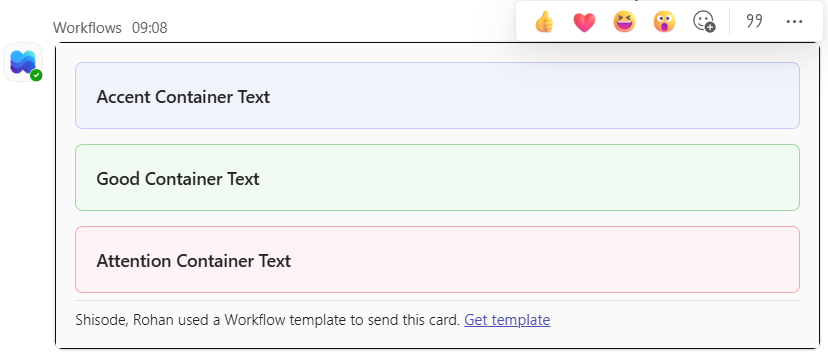
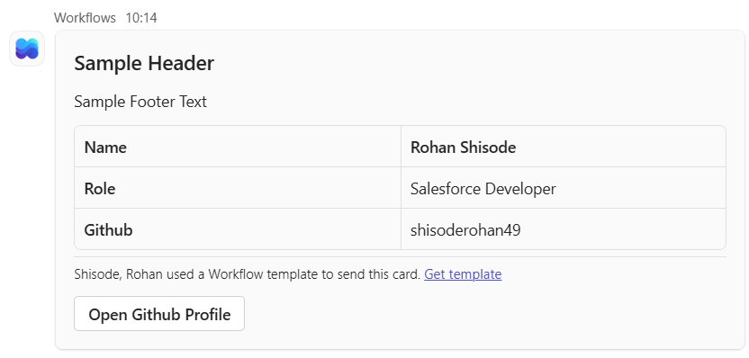

# MICROSOFT TEAMS ADAPTIVE CARD WEBHOOK ALERT FROM SALESFORCE

* In the chat, create a workflow from the template - `Send webhook alerts to a chat`
* Copy the webhook URL from the created workflow
* In the Salesforce Org, deploy the webhook URL as Named Credential

API name of the Named Credential is used as parameter in the Controller Class method to send the alert.

***

[Adaptive Card structure](https://learn.microsoft.com/en-us/adaptive-cards/authoring-cards/getting-started)  
The Basic structure of a card is as follows:  
* `Adaptive Card`  
Root object describes the AdaptiveCard itself  
* `body`  
The body of the card is made up of building-blocks known as elements.  
Elements can be composed in nearly infinite arrangements to create many types of cards.  
* `actions`  
Set of actions a user may take on a card.  
This property describes those actions which typically get rendered in an "action bar" at the bottom.  
  
Elements in this project implement the `AdaptiveCardElement` marker interface while   
Actions implement the `AdaptiveCardAction` marker interface.  
   
<p align="center">
  
</p>
   
***

**To Send Alerts from Apex Code**  
* Construct a `AdaptiveCardContent` instance by adding the required Elements and Actions  
* Use the above constructed instance as a parameter in `AdaptiveCardTeamsController`'s `sendAlert` method along with the API Name of the named credential  
   
To implement any other elements/actions, create a new class according to the properties required while implementing the necessary interface.  
Some special elements like Table require other concrete classes like AdaptiveCardRow, AdaptiveCardColumn, AdaptiveCardCell  
  
Current Implemented Elements/Actions for Adaptive Card -  
  
| Element/Action | Type    | Class(es)                                                                |
|----------------|---------|--------------------------------------------------------------------------|
| TextBlock      | Element | AdaptiveCardTextBox                                                      |
| Table          | Element | AdaptiveCardTable                                                        |
| Container      | Element | AdaptiveCardContainer                                                    |
| OpenUrl        | Action  | AdaptiveCardOpenUrlAction                                                |
   
***
  
`Adaptive Card Container Example`
```
AdaptiveCardContent content = new AdaptiveCardContent('1.5');

List<String> containerContent = new List<String>{'Accent Container Text', 'Good Container Text', 'Attention Container Text'};
List<String> containerStyles = new List<String>{'accent','good','attention'};

List<AdaptiveCardContainer> containerList = new List<AdaptiveCardContainer>();

for(Integer index = 0; index < containerContent.size(); index++){
    AdaptiveCardContainer container = new AdaptiveCardContainer(true,true).setStyle(containerStyles.get(index));
    AdaptiveCardTextBox text = new AdaptiveCardTextBox(containerContent.get(index)).setWeight('Bolder').setWrap(true);
    container.addItem(text);

    containerList.add(container);
}

content.addBodyElements(containerList);

AdaptiveCardTeamsController.sendAlert('TEAMS_WEBHOOK', content);
```
  
<p align="center">
  
</p>
  
---
  
`Adaptive Card Table Example`
```
//Creating Header Text Box Element for the Card 
AdaptiveCardTextBox header = new AdaptiveCardTextBox('Sample Header').setSize('Large').setWeight('Bolder');
AdaptiveCardTextBox footer = new AdaptiveCardTextBox('Sample Footer Text');

//Creating Table for the Card
AdaptiveCardTable table = new AdaptiveCardTable(true, false);
List<AdaptiveCardColumn> columns = new List<AdaptiveCardColumn>{new AdaptiveCardColumn(1), new AdaptiveCardColumn(1)};
table.addColumns(columns);

List<String> firstColumnList = new List<String>{'Name', 'Role', 'Github'};
List<String> secondColumnList = new List<String>{'Rohan Shisode', 'Salesforce Developer', 'shisoderohan49'};

//Adding Row Content to the Table
for(Integer index = 0; index < firstColumnList.size(); index++){
    AdaptiveCardRow row = new AdaptiveCardRow();

    AdaptiveCardCell firstCell = new AdaptiveCardCell();
    AdaptiveCardTextBox cellContent = new AdaptiveCardTextBox(firstColumnList.get(index)).setWeight('Bolder').setWrap(true);
    firstCell.addItem(cellContent);

    AdaptiveCardCell secondCell = new AdaptiveCardCell();
    AdaptiveCardTextBox cellContent2 = new AdaptiveCardTextBox(secondColumnList.get(index)).setWrap(true);
    secondCell.addItem(cellContent2);

    row.addCells(new List<AdaptiveCardCell>{firstCell, secondCell});

    table.addRow(row);
}

//Creating Open Url Action for the Card
AdaptiveCardOpenUrlAction action = new AdaptiveCardOpenUrlAction().setTitle('Open Github Profile').setUrl('https://github.com/shisoderohan49');

//Creating the final Content instance to be used for the Payload
AdaptiveCardContent content = new AdaptiveCardContent('1.5');
content.addBodyElements(new List<AdaptiveCardElement>{header, footer, table});
content.addActions(new List<AdaptiveCardAction>{action});

AdaptiveCardTeamsController.sendAlert('TEAMS_WEBHOOK',content);
```
  
<p align="center">
  
</p>