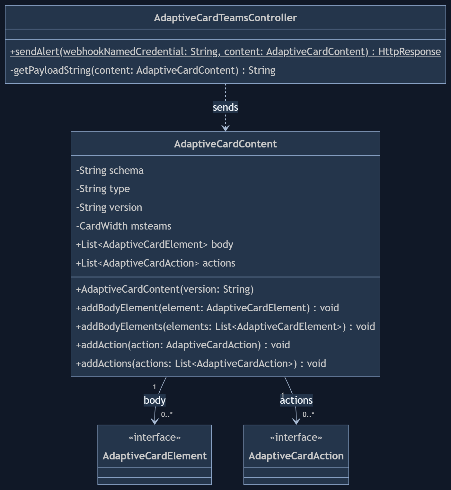
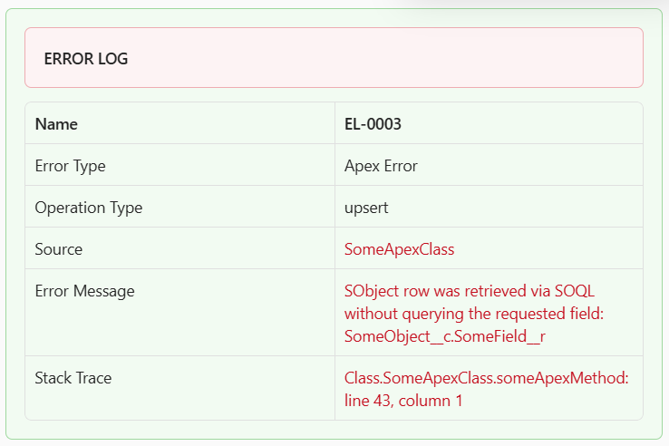

# Salesforce to Microsoft Teams Adaptive Card Alerts


  
Apex framework for constructing and sending rich Microsoft Teams Adaptive Cards directly from Salesforce using Named Credentials.  
   
## Overview

Sending alerts from Salesforce to Microsoft Teams often requires constructing complex JSON payloads.  
This library provides a Apex builder pattern that abstracts payload formatting and handles delivery seamlessly via Salesforce Named Credentials.
## Adaptive Card Schema
  
[Microsoft Adaptive Cards Documentation](https://learn.microsoft.com/en-us/adaptive-cards/authoring-cards/getting-started)  
The Basic structure of a card is as follows:  
* `Adaptive Card`  
Root object describes the AdaptiveCard itself  
* `body`  
The body of the card is made up of building-blocks known as elements.  
Elements can be composed in nearly infinite arrangements to create many types of cards.  
* `actions`  
Set of actions a user may take on a card.  
This property describes those actions which typically get rendered in an "action bar" at the bottom.  
   
## Architecture

* Elements implement `AdaptiveCardElement` 
* Actions implement `AdaptiveCardAction` 
* Reusable Layouts implement `AdaptiveCardTemplate`

<p align="center">
  
</p>
   
## Supported Elements & Actions  
   
| Element / Action | Type | Apex Class | Description |
| :--- | :--- | :--- | :--- |
| **TextBlock** | Element | `AdaptiveCardTextBox` | Displays formatted text blocks with custom weight, size, and wrapping. |
| **Container** | Element | `AdaptiveCardContainer` | Groups child elements with styled containers (`accent`, `good`, `attention`). |
| **Table** | Element | `AdaptiveCardTable` | Displays structured data across rows, columns, and cells. |
| **OpenUrl** | Action | `AdaptiveCardOpenUrlAction` | Adds an actionable button that opens an external link. |
     
## Setup & Configuration

#### 1. Deploy Code to Salesforce

```bash
sf config set target-org <your-org-alias>
sf project deploy start
```

#### 2. Configure Microsoft Teams
Choose one of the following methods to retrieve a webhook or API endpoint:
* Workflow Webhook  
In MS Teams, create a workflow using the template `Send webhook alerts to a chat` and copy the generated Workflow Webhook URL.  
* Microsoft Graph API  
Register an application in Microsoft Entra ID with appropriate Graph API permissions.  
  
#### 3. Configure Named Credentials
1. In Salesforce Setup, navigate to Named Credentials.
2. Create a new Named Credential (or External Credential if using Entra ID) using your Webhook/Graph endpoint.
3. Note the API Name of the Named Credential (e.g., TEAMS_WEBHOOK).
   
## Usage & Examples
  
### General Usage 

1. Create a new `AdaptiveCardContent` Class Instance
2. Construct the required Elements, Templates or Actions
3. Add Body Elements to the Content object by using `addElement(s)` or `addTemplate(s)` and Actions by using `addAction(s)`.
4. Send the alert by calling `sendAlert` method on `AdaptiveCardTeamsController` with Named Credential API Name and the Content object  

### Examples

#### Container Example

Create styled containers (`accent`, `good`, `attention`) to group related information:

```apex
AdaptiveCardContent content = new AdaptiveCardContent('1.5');

AdaptiveCardContainer accentContainer = new AdaptiveCardContainer(true,true).setStyle('accent');
AdaptiveCardTextBox accentText = new AdaptiveCardTextBox('Accent Container Text').setWeight('Bolder').setWrap(true);
accentContainer.addItem(accentText);

AdaptiveCardContainer goodContainer = new AdaptiveCardContainer(true,true).setStyle('good');
AdaptiveCardTextBox goodText = new AdaptiveCardTextBox('Good Container Text').setWeight('Bolder').setWrap(true);
goodContainer.addItem(goodText);

AdaptiveCardContainer attentionContainer = new AdaptiveCardContainer(true,true).setStyle('attention');
AdaptiveCardTextBox attentionText = new AdaptiveCardTextBox('Attention Container Text').setWeight('Bolder').setWrap(true);
attentionContainer.addItem(attentionText);

content.addBodyElements(new List<AdaptiveCardContainer>{accentContainer, goodContainer, attentionContainer});

AdaptiveCardTeamsController.sendAlert('TEAMS_WEBHOOK', content);
```

<p align="center">
  
</p>

#### Table Template Example

Using `AdaptiveCardTableTemplate` for rapid error logging or key-value data formatting:

```apex
AdaptiveCardContent content = new AdaptiveCardContent('1.5');

AdaptiveCardContainer cardContainer = new AdaptiveCardContainer(true,true).setStyle('good');

AdaptiveCardContainer attentionContainer = new AdaptiveCardContainer(true,true).setStyle('attention');
AdaptiveCardTextBox headerBox = new AdaptiveCardTextBox('ERROR LOG').setWeight('Bolder').setWrap(true);
attentionContainer.addItem(headerBox);

List<List<String>> tableContent = new List<List<String>>();
tableContent.add(new List<String>{'Name', 'EL-0003'});
tableContent.add(new List<String>{'Error Type', 'Apex Error'});
tableContent.add(new List<String>{'Operation Type', 'upsert'});
tableContent.add(new List<String>{'Source', 'SomeApexClass'});
tableContent.add(new List<String>{'Error Message', 'SObject row was retrieved via SOQL without querying the requested field: SomeObject__c.SomeField__r'});
tableContent.add(new List<String>{'Stack Trace', 'Class.SomeApexClass.someApexMethod: line 43, column 1'});

AdaptiveCardTableTemplate table = new AdaptiveCardTableTemplate(tableContent);
table.setRoundedCorners(true);
table.setCellColor(4,2,'Attention');
table.setCellColor(5,2,'Attention');
table.setCellColor(6,2,'Attention');

cardContainer.addItem(attentionContainer);
cardContainer.addItems(table.getElements());

content.addBodyElement(cardContainer);

AdaptiveCardTeamsController.sendAlert('TEAM_WEBHOOK',content);
```

<p align="center">
  
</p>
   
#### Table with OpenURL Action Example

Combine custom tables with interactive action buttons:  
```apex
// Header & Footer
AdaptiveCardTextBox header = new AdaptiveCardTextBox('Sample Header').setSize('Large').setWeight('Bolder');
AdaptiveCardTextBox footer = new AdaptiveCardTextBox('Sample Footer Text');

// Table Structure
AdaptiveCardTable table = new AdaptiveCardTable(true, false);
table.addColumns(new List<AdaptiveCardColumn>{new AdaptiveCardColumn(1), new AdaptiveCardColumn(1)});

List<String> keys = new List<String>{'Name', 'Role', 'GitHub'};
List<String> values = new List<String>{'Rohan Shisode', 'Salesforce Developer', 'shisoderohan49'};

for (Integer i = 0; i < keys.size(); i++) {
    AdaptiveCardRow row = new AdaptiveCardRow();

    AdaptiveCardCell cell1 = new AdaptiveCardCell();
    cell1.addItem(new AdaptiveCardTextBox(keys.get(i)).setWeight('Bolder').setWrap(true));

    AdaptiveCardCell cell2 = new AdaptiveCardCell();
    cell2.addItem(new AdaptiveCardTextBox(values.get(i)).setWrap(true));

    row.addCells(new List<AdaptiveCardCell>{cell1, cell2});
    table.addRow(row);
}

// Action Button
AdaptiveCardOpenUrlAction action = new AdaptiveCardOpenUrlAction()
    .setTitle('Open GitHub Profile')
    .setUrl('https://github.com/shisoderohan49');

// Construct Payload & Send
AdaptiveCardContent content = new AdaptiveCardContent('1.5');
content.addBodyElements(new List<AdaptiveCardElement>{header, footer, table});
content.addActions(new List<AdaptiveCardAction>{action});

AdaptiveCardTeamsController.sendAlert('TEAMS_WEBHOOK', content);
```

<p align="center">
  
</p>

## Extending the Framework

To implement new Adaptive Card elements or actions:
1. **New Element** - Create a class implementing `AdaptiveCardElement`
2. **New Action** - Create a class implementing `AdaptiveCardAction`
3. **New Template** - Create a class implementing `AdaptiveCardTemplate` and return a `List<AdaptiveCardElement>` from `getElement()`  
   
### Templates

Templates provide reusable sections of Adaptive Card elements.  
They build the individual elements for you, so you can reuse common layouts without repeatedly creating and configuring each small element by hand. 
  
* Define a template by implementing the `AdaptiveCardTemplate` interface and returning its elements from `getElements()`. 
* Add those elements to an `AdaptiveCardContent` instance with `addBodyElements()` or any other element which has child elements (e.g Container)

---